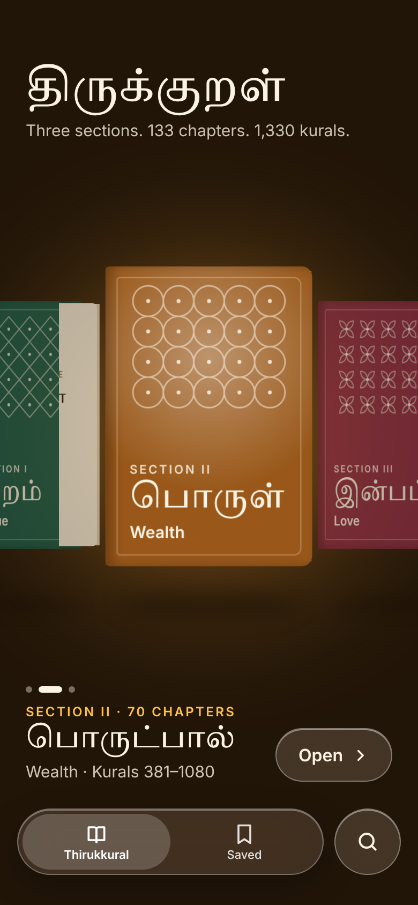
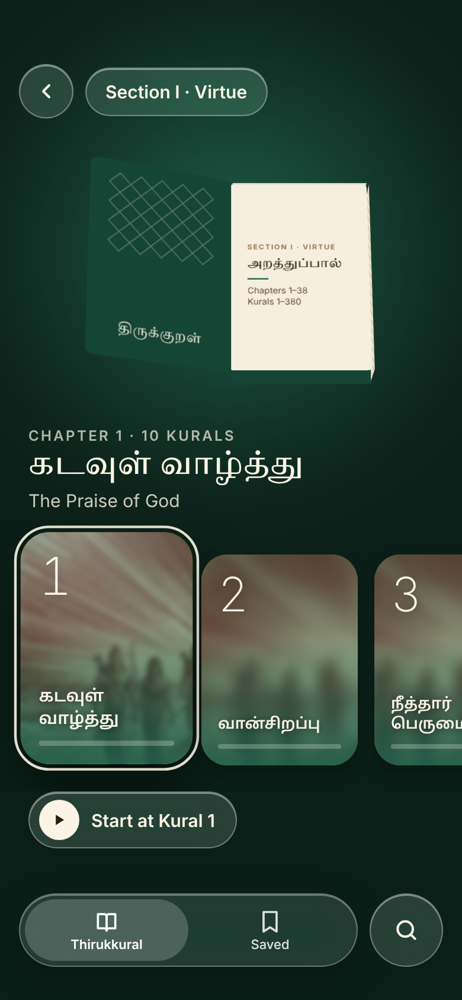
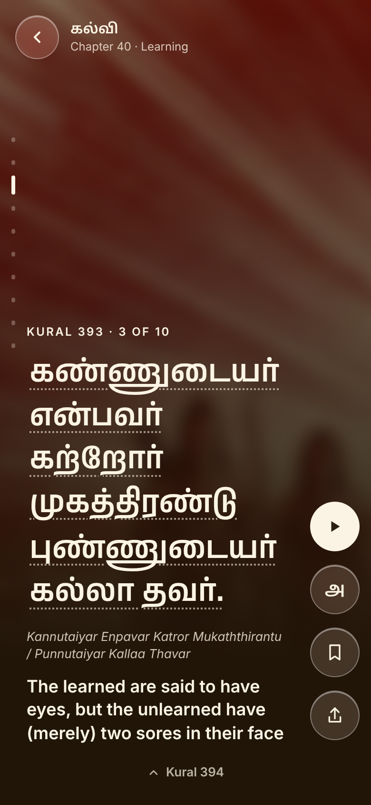
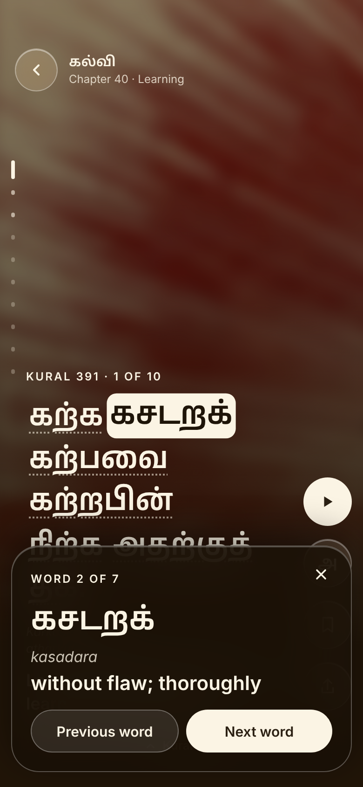
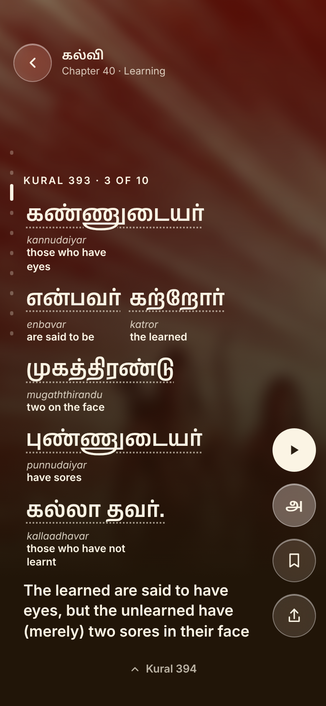

# Thirukkural

A visual reader for all 1,330 kurals of the Thirukkural. Three sections appear as 3D books. Each book opens to its chapters, and each chapter opens a full-screen reader. Tap any Tamil word to learn it.



| Section | Reader | Word meaning | Word by word |
| --- | --- | --- | --- |
|  |  |  |  |

## What it does

- All 3 sections, 133 chapters and 1,330 kurals, loaded one chapter at a time
- Swipe, scroll or use arrow keys to move between kurals. The end of a chapter returns you to its section
- Tap a word for its pronunciation and meaning, or turn on word by word study mode
- Reading progress, saved kurals and your last position are kept on the device
- Every kural has its own link, for example `#kural-393`
- Installable to the home screen, and works offline once chapters have been opened

## Run it locally

No build step. Serve the folder with any static server:

```sh
python3 -m http.server 8000
```

Then open http://localhost:8000.

## Install on a phone

Once the site is live on GitHub Pages:

- **iPhone:** open the link in Safari, tap Share, then Add to Home Screen
- **Android:** open the link in Chrome, then tap Install app

## Project structure

```
index.html               App markup
css/styles.css           All styling
js/config.js             Section colours and chapter artwork
js/app.js                App logic
data/index.json          Sections and chapters (generated)
data/chapters/NNN.json   Kurals for each chapter (generated)
data-src/                Source data and draft word meanings
scripts/build_data.py    Builds data/ from data-src/
sw.js                    Offline support
manifest.webmanifest     Home screen install settings
assets/                  Icons and chapter artwork
```

## Updating content

Edit files in `data-src/`, then rebuild:

```sh
python3 scripts/build_data.py
```

Word meanings live in `data-src/glosses.json`, keyed by kural number. Each word is `[tamil, transliteration, meaning]`. Kurals without an entry still show pronunciation where available.

When app files change, bump `VERSION` in `sw.js` so installed copies pick up the update.

## Chapter artwork

Every chapter uses `assets/chapter-placeholder.jpg` for now. To give a chapter its own image, add it to `assets/` and map it in `js/config.js`:

```js
chapterArt: { 40: 'assets/chapters/040.jpg' }
```

## Content sources

- **Tamil text:** Thiruvalluvar's Thirukkural is in the public domain
- **Dataset:** [tk120404/thirukkural](https://github.com/tk120404/thirukkural), Apache License 2.0. A copy of the licence is in `data-src/vendor/tk120404/LICENSE`. Chapter names, transliteration and English meanings come from this dataset
- **Font:** [Anek Tamil](https://github.com/EkType/Anek), SIL Open Font License 1.1, in `assets/fonts/`
- **Placeholder artwork:** generated with Google Gemini
- **Word meanings:** drafts for chapters 1, 40 and 109 only. These need review by a Tamil scholar before wider release

The dataset also includes Tamil commentaries and a second English translation. These are not used until their rights are confirmed.

## Roadmap

- Word meanings for every chapter
- Artwork for each chapter
- Audio recitation
- Native iOS app for TestFlight
